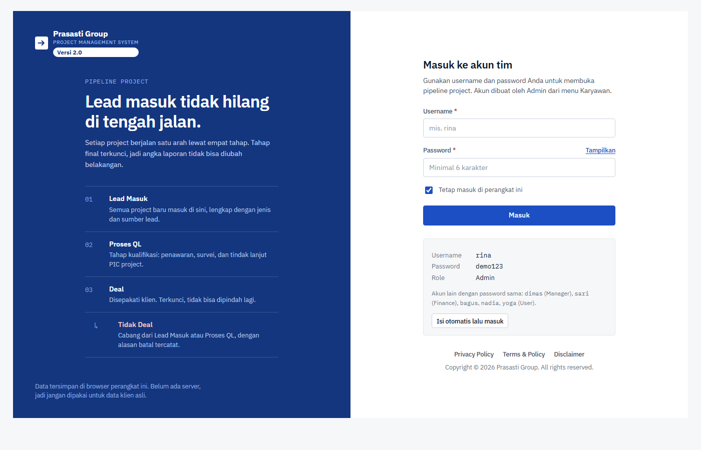

<div align="center">

<!-- logo -->


<h1>Prasasti Group · Project Management System</h1>

<p>
  <strong>Pipeline project tanpa lead hilang di tengah jalan.</strong><br />
  Lead Masuk → Proses QL → Deal / Tidak Deal, terkunci permanen di tahap final.<br />
  <em>Vanilla HTML / CSS / JS — tanpa build — jalan langsung di browser.</em>
</p>

<p>
  <a href="#"></a>
  <a href="#"></a>
  <a href="#"></a>
  <a href="LICENSE"></a>
  <a href="_v-login.png"></a>
</p>

<p align="center">
  <a href="#-quick-start">Quick Start</a> ·
  <a href="#-features">Features</a> ·
  <a href="#-pipeline-rules">Pipeline Rules</a> ·
  <a href="#-roles--permissions">Roles</a> ·
  <a href="#-reports">Reports</a> ·
  <a href="#-storage">Storage</a> ·
  <a href="#-roadmap">Roadmap</a>
</p>

</div>

---

## ✨ Key Highlights

|   |   |
|---|---|
| 🎯 | **4-tahap kanonis** — `Lead → QL → Deal / Lost`. Final terkunci, tidak bisa mundur. |
| 🔒 | **Gerbang wajib** — tanpa nominal + Quotation tidak bisa jadi Deal. |
| 📄 | **Dokumen per Deal** — Quotation, RAB, Proposal, SPK. Chip <span color="#16a34a">hijau</span>/<span color="#ca8a04">kuning</span>/<span color="#6b7280">abu</span> per project. |
| 📊 | **Laporan berbasis histori** — bukan snapshot sekarang. Angka bisa > tab pipeline. |
| 🏷️ | **Nomor QL otomatis** — `PSQL-`, `PLQL-`, `MGQL-`, `MDQL-`, `WSQL-` per tipe project. |
| 👥 | **4 role** — User, Finance, Manager, Admin. PIC jalankan, Finance lengkapi dokumen. |
| 💾 | **0 server** — `localStorage` + `IndexedDB`. Tanpa database eksternal. |
| ⚡ | **0 build, 0 dependency** — chart CSS/SVG, font opsional, keyboard-first. |

---

## 🚀 Quick Start

No build step. Static file only.

```powershell
# 1. masuk folder project
cd "Project Management V2"

# 2. jalankan server statis apa pun
npx serve .
# atau: python -m http.server 3000

# 3. buka
# http://localhost:3000/login.html
```

> ⚠️ Data tersimpan di browser ini saja. Jangan pakai untuk data client asli.

### 🤖 Demo Accounts

Semua password: **`demo123`**

| Username | Role | Akses singkat |
|---|---|---|
| `rina` | Admin | semua + kelola akun |
| `dimas` | Manager | semua project, termasuk hapus & Tidak Deal |
| `sari` | Finance | dokumen & nominal Deal |
| `bagus`, `nadia`, `yoga` | User | project yang dia pegang (PIC) |

Tidak ada pendaftaran mandiri. Akun dibuat Admin dari menu **Karyawan**.

Username unik 3–40 karakter: huruf kecil, angka, titik, garis bawah, atau strip.  
Migrasi otomatis: akun lama format email (`rina@tim.local`) dipindah jadi `rina` tanpa ubah password.

---

## 🧭 Features

### Pipeline Project
- Tab: **Semua Project**, Lead Masuk, Proses QL, Deal, Tidak Deal — count per tab.
- Search (`/`), sort, filter stage / entitas / tipe / PIC / status QL / dokumen / rentang tanggal.
- Pagination serverless 50/baris, bulk select + **Hapus yang dipilih**.
- Muat **13 data contoh** sekali klik saat tabel masih kosong.
- Pintasan: `N` buat baru, `B` sidebar, `Enter` detail, `Esc` tutup dialog.

### Clients
- Satu client, banyak project. Update PIC/WA/email sekali → berlaku semua project.
- Autocomplete nama perusahaan saat input project. Mengetik baru = buat client otomatis.
- Halaman client: jumlah project, sebaran tahap, total nilai deal, terakhir aktif.
- Client yang masih dipakai project **tidak bisa dihapus**.

### Dokumen
- Maks 10 MB/file: PDF, Word, Excel, gambar. Preview PDF/gambar di tab baru.
- QL: Quotation & Proposal bisa diunggah di panel detail, dibawa ke Deal.
- Deal wajib: Quotation selalu, RAB wajib untuk Prasasti Selaras, Proposal & SPK opsional.
- Ellipsis penggantian: ganti dokumen = hapus file lama dari IndexedDB.

### Laporan
Filter tanggal global: 30 / 90 hari, tahun ini, semua waktu. Rentang terbalik dirapikan sendiri.

| Tab | Isi |
|---|---|
| **Ringkasan** | 4 kartu tahap, corong pipeline + closing rate, donut Cold/Hot, bar sumber lead, tipe, kategori, entitas |
| **Sales** | per karyawan: lead, QL, Deal, Tidak Deal, closing rate, nilai deal. Multi-PIC dihitung ke tiap PIC. |
| **Prospek** | total / rata-rata / terbesar nilai deal, hot prospect belum Deal + potensi, closing per jenis lead, nilai per tipe/kategori/entitas |

Export **Excel (.xlsx)** dari tabel project. Angka laporan dihitung dari `history[]` perpindahan tahap.

### Karyawan & Master Data
- Karyawan: buat/edit/nonaktifkan/aktifkan lagi. Nonaktif tetap tampil sebagai nama terakhir di project lama.
- Bulk create akun dari teks, validasi username.
- Master Data: tipe project, kategori, entitas, sumber lead. Riwayat 20 versi + Reset default. Hapus kategori ditolak bila masih dipakai.
- Audit field `db.audit` (maks 500): create / update / stage / user / master. Tampil di panel detail *Riwayat perubahan field*.

---

## 🔄 Pipeline Rules

Satu-satunya sumber kebenaran, `app.js`:

```js
const NEXT = { lead: ['ql', 'lost'], ql: ['deal', 'lost'], deal: [], lost: [] };
```

- **Deal & Tidak Deal terkunci.** Tanpa tombol pindah, tanpa jalur mundur.
- Duluan: perpindahan QL bisa diurungkan, nomor QL tetap melekat dan dipakai ulang.
- **Gerbang Proses QL** wajib: status QL (`Belum dikerjakan` / `Sedang dikerjakan`) + nilai penawaran.
- **Gerbang Deal** wajib: nominal deal (default dari penawaran) + Quotation (semua tipe) + RAB (Prasasti Selaras).

### Nomor QL per tipe

| Tipe project | Awalan |
|---|---|
| Prasasti Selaras | `PSQL-0001` |
| Prasasti Lestari | `PLQL-0001` |
| Mutiari Garden | `MGQL-0001` |
| Mutiari Decoration | `MDQL-0001` |
| Wood and Steel | `WSQL-0001` |

Tipe terkunci setelah nomor QL terbit. Kategori tetap bisa diubah.

### Form Project

**Wajib:** nama, tipe, kategori (bila ada daftar), entitas, jenis lead, sumber lead, perusahaan, PIC client, WA, minimal 1 PIC project.  
**Opsional:** email, deskripsi, tanggal kegiatan (`start`–`end`, akhir tidak boleh < mulai).

Entitas **tidak terikat** tipe project:

| Kode | Badan usaha |
|---|---|
| `PSS` | Prasasti Selaras Sinergi |
| `PS` | CV Prasasti |
| `MAW` | Mutiari Adi Warna |
| `MGI` | PT Mutiari Garden Indonesia |
| `PWS` | Prasasti Widya Sejahtera |

---

## 👔 Roles & Permissions

| Tindakan | User | Finance | Manager | Admin |
|---|:---:|:---:|:---:|:---:|
| Lihat semua project & laporan | ✓ | ✓ | ✓ | ✓ |
| Buat project | ✓ | – | ✓ | ✓ |
| Edit / pindah tahap | PIC saja | – | ✓ | ✓ |
| Nominal deal & dokumen | PIC saja | ✓ | ✓ | ✓ |
| Kelola client | ✓ | – | ✓ | ✓ |
| Tidak Deal / Hapus project | – | – | ✓ | ✓ |
| Kelola akun & role | – | – | – | ✓ |

- **User (PIC)** menjalankan lead → Deal. **Finance** melengkapi dokumen & nominal Deal.
- Tombol tidak diizinkan tampil disabled + alasan role. Tidak disembunyikan.
- Admin terakhir tidak bisa diturunkan role-nya atau dinonaktifkan.
- Matriks di `CAN` (`app.js`). Role ditegakkan di klien — bukan pengganti backend.

---

## 💾 Storage

| Lapisan | Isi | Kunci |
|---|---|---|
| `localStorage` | user, session, project, client, audit, master | `alur:users:v1`, `alur:session:v1`, `alur:data:v2` |
| `IndexedDB` `alur-files` | blob dokumen (PDF/Word/Excel/gambar) | metadata saja di localStorage |

- Sesi: **12 jam** bila centang *Tetap masuk di perangkat ini*, **1 jam** bila tidak. Token tersimpan di `localStorage` / `sessionStorage`.
- Rate-limit login: 5 gagal / 15 menit.
- Multi-tab sinkron via event `storage`.
- Password: hash SHA-256 dengan salt per akun. Cukup untuk demo lokal.
- **Tidak ada sinkronisasi antar perangkat.** Untuk produksi: pindah `store.js` jadi panggilan API.

---

## 🛠️ Tech Stack

| Layer | Pilihan |
|---|---|
| UI | Vanilla HTML + CSS (`styles.css`, IBM Plex Sans/Mono opsional) |
| Logika | Vanilla JS, 1 IIFE per halaman (`app.js`, `login.js`, `store.js`) |
| Data | `localStorage` + `IndexedDB`, chart CSS/SVG hand-made |
| Test | `npm run check` (lint `node --check` + `node --test`) |
| CI | GitHub Actions, Node 22 (`.github/workflows/ci.yml`) |

```powershell
npm run lint   # node --check store/app/login.js
npm run test   # node --test tests/rules.test.js
npm run check  # lint + test
```

---

## 📁 Project Structure

```
.
├── login.html · login.js      # halaman masuk (username + password)
├── index.html · app.js        # aplikasi: pipeline, clients, laporan, karyawan, master
├── store.js                   # akun, sesi, data project, berkas
├── styles.css                 # seluruh gaya
├── privacy.html · policy.html · disclaimer.html
├── tests/rules.test.js
├── package.json               # check / lint / test
└── .github/workflows/ci.yml
```

Konstanta penting di `app.js`: `STAGES`, `NEXT`, `PROJECT_TYPES`, `ENTITIES`, `SOURCES`, `DOCS`, `CAN`, `QL_STATUS`, `LEAD_KINDS`. Pindah ke server tanpa ubah struktur UI.

---

## 🗺️ Roadmap

| Prioritas | Fitur |
|---|---|
| **P0** | Server + database (`store.js` → API), auth server-side (bcrypt/argon2), backup JSON + restore |
| **P1** | Recycle bin (soft-delete), aktivitas & follow-up log, reminder jatuh tempo, lampiran bebas |
| **P2** | Kanban drag-drop, HPP/margin/termin, template & duplikat project, import Excel |
| **P3** | Generate Quotation/SPK, e-sign, portal client, automation rules, forecast & aging |

---

## 📜 Legal & Copyright

Legal dapat dibuka tanpa login dari footer login, aplikasi, dan halaman legal: `privacy.html`, `policy.html`, `disclaimer.html`.

Copyright © 2026 Prasasti Group. All rights reserved.  
Internal use only — jangan pakai untuk data client asli sebelum server aktif.

---

<div align="center">

**Prasasti Group · Project Management System Versi 2.1** — lead masuk tidak hilang di tengah jalan.

</div>
